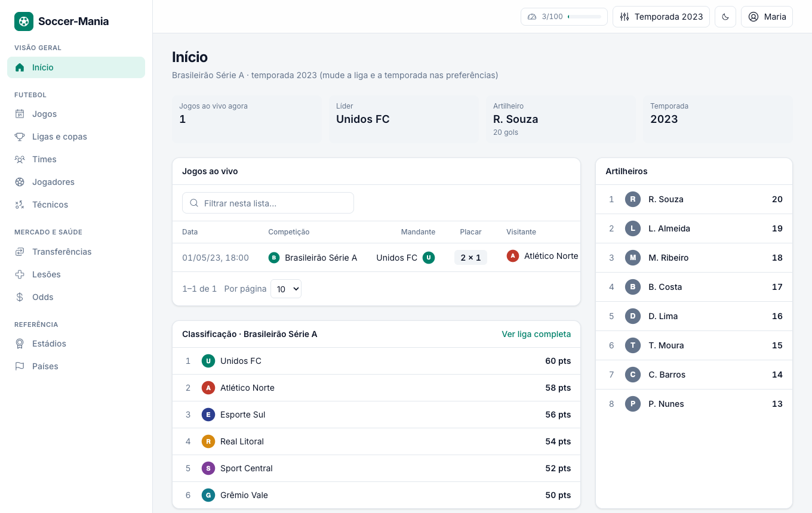
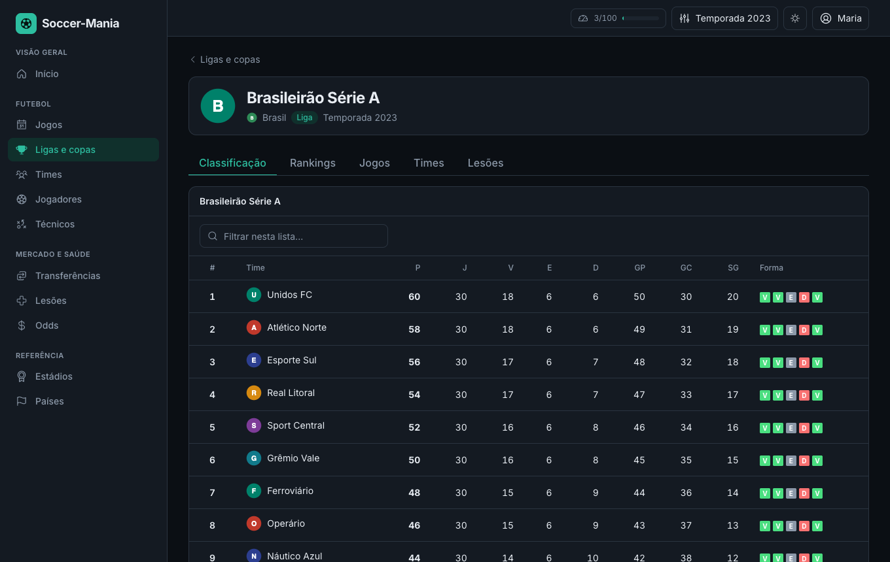
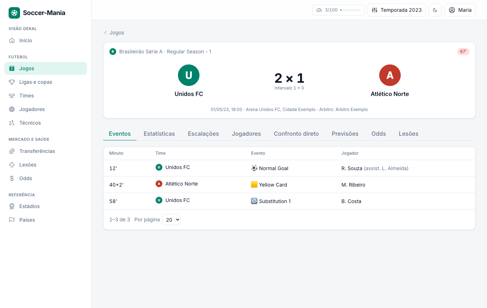
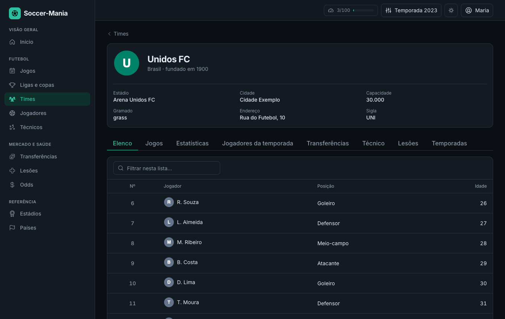
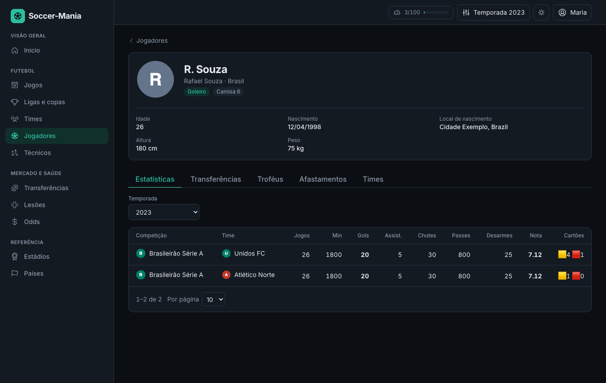
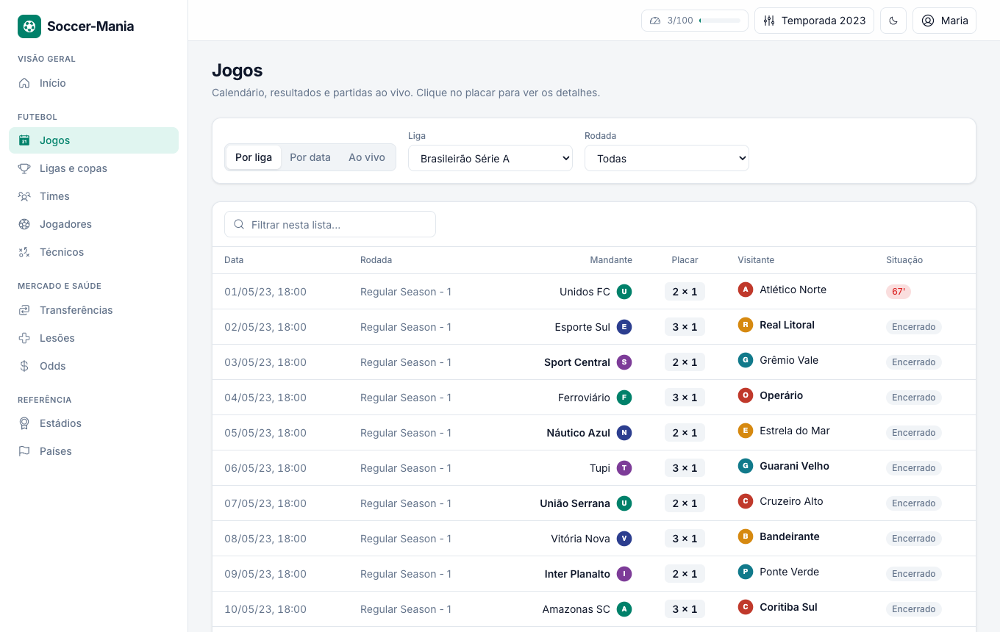
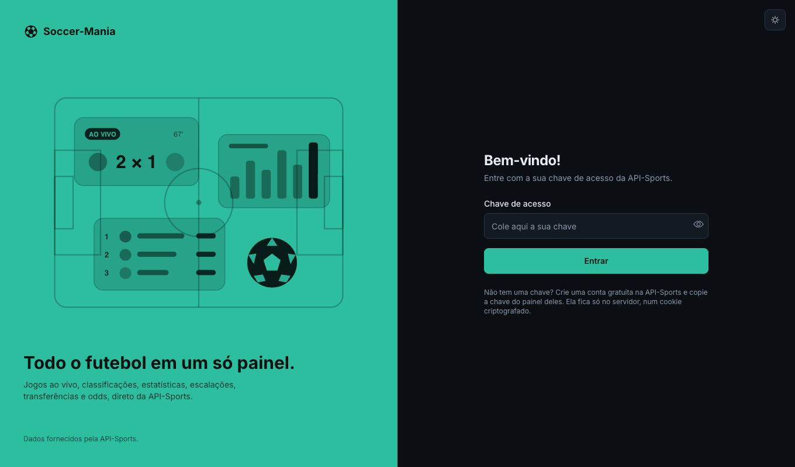
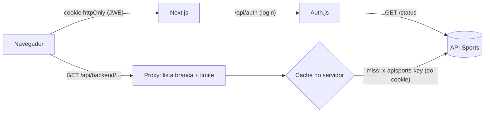

<p align="center"></p>

<h3 align="center">Todo o futebol da API-Sports em um painel, com tema claro e escuro</h3>

<p align="center">
  
  
  
  
  
  
  
</p>

Painel de futebol (Next.js, TypeScript, Tailwind e Chakra UI) que consome **todos os endpoints da
[API-Sports](https://www.api-football.com/documentation-v3)** (jogos ao vivo, ligas, classificações, times, jogadores,
técnicos, escalações, estatísticas, previsões, odds, transferências, lesões, troféus, estádios e países). Você entra com a
sua **chave de acesso** da API-Sports.



## O que este projeto demonstra

| Área                        | O que foi aplicado                                                                                                                                                                                                      |
| --------------------------- | ----------------------------------------------------------------------------------------------------------------------------------------------------------------------------------------------------------------------- |
| **Segurança**               | a chave **nunca** chega ao navegador: fica num cookie criptografado e `httpOnly` (Auth.js) e um proxy no servidor do Next a injeta na chamada                                                                           |
| **Proxy com lista branca**  | só `GET`, só os 38 endpoints conhecidos, só com os parâmetros de cada um e valores validados por regex; o resto é 404/400 (e o `/status` fica fora)                                                                     |
| **Cota da API**             | cache no servidor com TTL por tipo de dado (30 s ao vivo, horas para dados estáticos), abas que só consultam quando abertas, `staleTime` alto e indicador de uso diário no topo. O plano gratuito permite ~100 por dia |
| **Limite de uso**           | login: 5 tentativas por IP a cada 15 min; proxy: 120 chamadas por minuto por IP                                                                                                                                         |
| **Interface**               | menu lateral responsivo, tema **claro/escuro** (segue o sistema, escolha salva), tabelas com **paginação, ordenação, filtro e tamanho de página**, paginação do servidor onde a API pagina, estados de carregando/erro/vazio |
| **Acessibilidade**          | tabelas com `aria-label`, `aria-sort`, `aria-current`, foco visível, alertas com `role="alert"`                                                                                                                         |
| **Testes**                  | Vitest (lista branca, cache, limitador, formatação, paginação) e **Playwright** contra uma API-Sports falsa (login, bloqueio, proxy, cache, navegação, paginação, abas, tema, plano gratuito, 404)                       |
| **Qualidade e CI**          | Prettier + ESLint (`next/core-web-vitals`) + `tsc` + GitHub Actions (checks e e2e) + Dependabot                                                                                                                         |
| **Docker**                  | `docker compose` com healthcheck em `/api/health`                                                                                                                                                                       |

| Tema escuro: liga                    | Jogo (claro)                        |
| ------------------------------------ | ----------------------------------- |
|  |  |

| Time (escuro)                        | Jogador (escuro)                          |
| ------------------------------------ | ----------------------------------------- |
|  |  |

| Jogos com paginação                   | Login                                 |
| ------------------------------------- | ------------------------------------- |
|  |  |

> As capturas usam uma API-Sports **falsa** (`e2e/mock-api-football.mjs`) com dados fictícios.

## O que cada tela faz

| Tela                   | Endpoints da API-Sports                                                                                                                                  |
| ---------------------- | -------------------------------------------------------------------------------------------------------------------------------------------------------- |
| **Início**             | `fixtures?live`, `standings`, `players/topscorers`                                                                                                       |
| **Jogos**              | `fixtures` (por liga e rodada, por data, ao vivo), `fixtures/rounds`                                                                                     |
| **Jogo**               | `fixtures?id`, `fixtures/events`, `fixtures/statistics`, `fixtures/lineups`, `fixtures/players`, `fixtures/headtohead`, `predictions`, `odds`, `odds/live`, `injuries` |
| **Ligas e copas**      | `leagues` (filtro por tipo)                                                                                                                              |
| **Liga**               | `standings`, `players/topscorers`, `topassists`, `topyellowcards`, `topredcards`, `fixtures`, `teams`, `injuries`                                        |
| **Times**              | `teams` (por liga, país ou nome), `countries`                                                                                                            |
| **Time**               | `teams?id`, `players/squads`, `fixtures`, `leagues?team`, `teams/statistics`, `players`, `transfers`, `coachs`, `injuries`, `teams/seasons`             |
| **Jogadores**          | `players/profiles` (busca por nome), `players` (por liga, com filtro)                                                                                    |
| **Jogador**            | `players/profiles`, `players/seasons`, `players`, `transfers`, `trophies`, `sidelined`, `players/teams`                                                  |
| **Técnicos / Técnico** | `coachs` (busca e perfil), `trophies?coach`, `sidelined?coach`                                                                                           |
| **Transferências**     | `teams?search`, `transfers`                                                                                                                              |
| **Lesões**             | `injuries` (por liga ou data)                                                                                                                            |
| **Odds**               | `odds`, `odds/mapping`, `odds/bookmakers`, `odds/bets`, `odds/live/bets`                                                                                 |
| **Estádios / Países**  | `venues`, `countries`, `teams/countries`                                                                                                                 |
| **Preferências**       | `timezone`, `leagues/seasons` (temporada e fuso dos horários)                                                                                            |

## Arquitetura



1. `/login`: Auth.js recebe a chave **no servidor**, valida o formato e confere em `GET /status` (assinatura ativa).
2. A chave entra no JWT da sessão, que o Auth.js criptografa no cookie `httpOnly`. O navegador nunca a lê de volta.
3. O navegador chama `/api/backend/...`; o proxy valida rota e parâmetros, aplica o limite, consulta o cache e só então chama a API-Sports.

## Como rodar

**Docker** (porta `3080`):

```bash
cp .env.example .env          # preencha AUTH_SECRET: openssl rand -hex 32
docker compose -f docker-compose.dev.yml up -d --build -V
# abra http://localhost:3080/login e entre com a sua chave da API-Sports
```

**Sem Docker** (Node 20+):

```bash
cp .env.example .env && npm ci && npm run dev -- -p 3080
```

Não tem chave? Rode `node e2e/mock-api-football.mjs` e suba o app com `API_FOOTBALL_URL=http://localhost:3082`; a chave
de demonstração está em `e2e/chave-demo.json`.

## Verificação

```bash
npm run format:check && npm run lint && npm run typecheck
npm test            # Vitest
npm run test:e2e    # Playwright (sobe a API falsa e o app sozinho; usa o Chrome instalado)
npm run build
npm run screenshots # refaz as capturas do README
```

## Portas

| Serviço              | Host            |
| -------------------- | --------------- |
| App (Next)           | `3080`          |
| e2e: API falsa / app | `3082` / `3083` |

## Decisões e limitações

- **Por que Next.js e não só o Vite que existia:** para ter um servidor onde a chave fica protegida. Sem ele não há
  como esconder uma chave de um app que roda só no navegador.
- **Cache e limitador em memória:** valem para uma instância. Com várias instâncias o estado iria para o Redis.
- **Cache compartilhado:** as respostas são dados públicos, então servem para qualquer usuário logado; erros (cota, plano) nunca são cacheados.
- **Plano gratuito:** cobre as temporadas 2021 a 2023 e ~100 requisições por dia. A temporada padrão é **2023**; troque em
  "Preferências". Fora do plano a API responde com erro e a tela mostra a explicação em português.
- **Paginação:** a API só pagina `players`, `players/profiles`, `odds` e `odds/mapping` (paginação do servidor). As demais
  listas vêm inteiras e a tabela pagina no navegador.
- **Não testado com chave real em CI:** o e2e usa a API falsa; a chamada à API-Sports de verdade só foi exercitada à mão.
- **Odds ao vivo e previsões** dependem do plano e da cobertura da competição; quando não há dado a tela diz isso.

## Contato

Dúvidas ou colaborações: isaqueferreiradesousa@gmail.com
